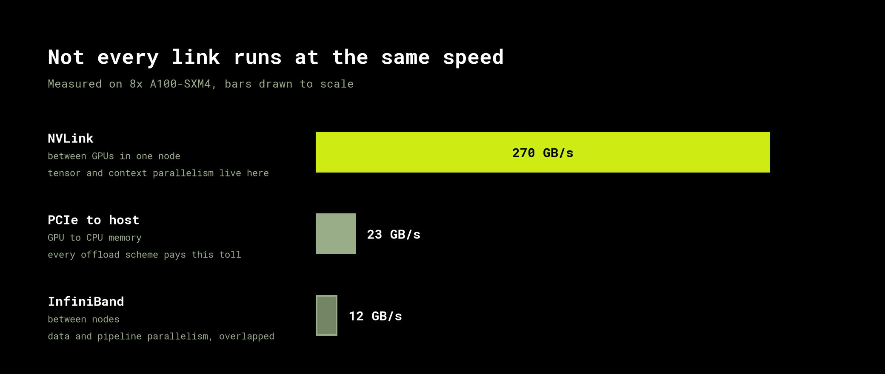

# Meet your cluster

Everything in this course is a trade between compute and communication, and you
cannot price that trade until you know what the wires in your own machine actually
do. Two GPUs in one chassis might be joined by a link that moves 270 GB/s, or by one
that moves 23. So we measure the machine before any theory.

