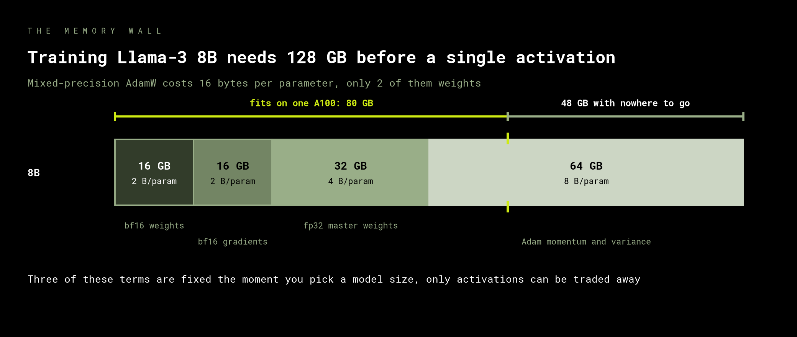

# The memory wall

A model that trains fine on paper will not load at all, and the reason is almost
never the weights. This module accounts for every byte an optimizer step holds, then
watches a real step allocate them and hands you a number you can plan against.

