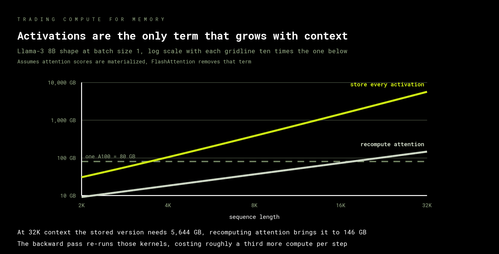

# Recompute and accumulate

Activations are the one term in the memory budget you can negotiate with. Throw them
away on the way forward, rebuild them on the way back, and pay for the memory in
arithmetic. It is the first real trade in the course, and you get to measure both sides.

