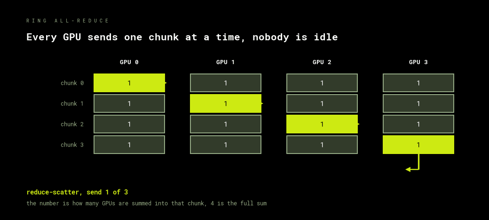

# Collectives

Eight GPUs holding eight different gradients have to end up holding one. Almost all of
distributed training is six operations that move data between ranks, plus one identity
that the rest of the course leans on heavily.

