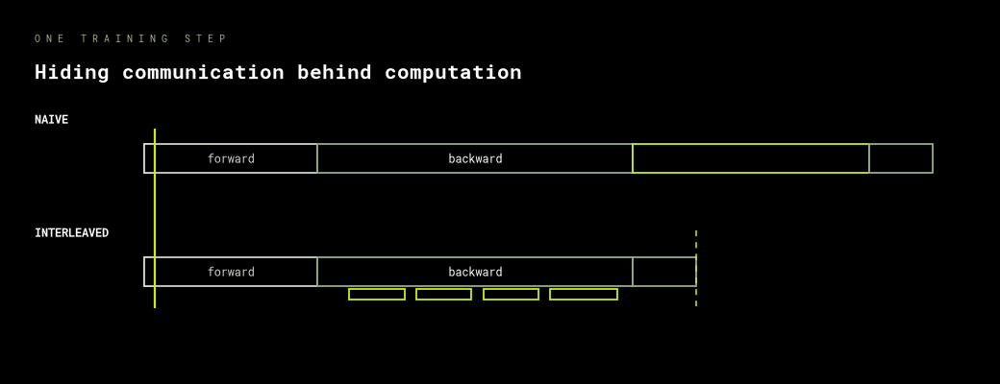

# Data parallelism

Replicate the model, split the batch, average the gradients. You expect eight times the
throughput, you measure five, and the missing three are sitting on the network waiting
for an all-reduce that nobody thought to overlap.

Needs at least two GPUs. Both notebooks adapt to however many they find.

