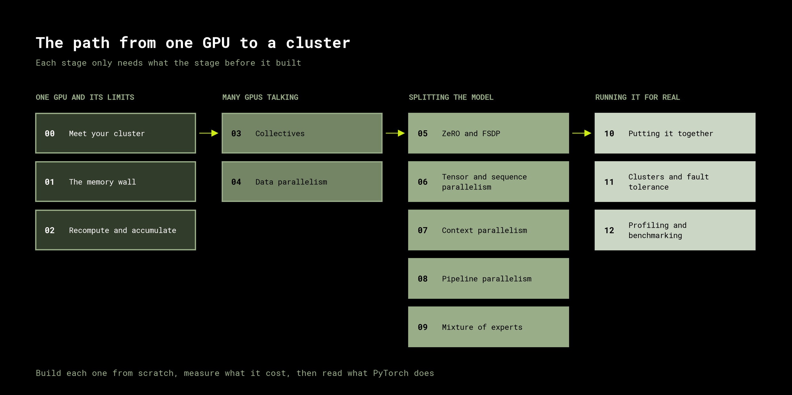

# Distributed Training From Scratch

Training a 405B-parameter model takes about 6.5 TB of memory. An H100 has 80 GB.

Closing that gap is the whole subject. Every technique in this course exists to split a
model across hundreds of GPUs, keep all of them busy, and hide the network behind the
math. We build each one from scratch on real hardware, measure what it costs, and only
then read what PyTorch, DeepSpeed and Megatron do in production.



## Setup

Everything runs through [uv](https://docs.astral.sh/uv/). Install it if the machine does
not have it already:

```bash
curl -LsSf https://astral.sh/uv/install.sh | sh
```

It lands in `~/.local/bin`. If the shell still cannot find `uv`, open a new one or add
that directory to `PATH`.

```bash
git clone https://github.com/debnsuma/distributed-training-from-scratch.git
cd distributed-training-from-scratch
uv sync
uv run jupyter lab
```

That is the whole install. `uv sync` builds the environment from `uv.lock` and
`.python-version`, which together pin the interpreter and every package, CUDA-enabled
PyTorch and JupyterLab included. No conda, no pip, no manual CUDA wrangling. Run
everything through `uv run` and nothing needs activating.

## What you need

| | |
|---|---|
| GPUs | One is enough to start. Collectives and anything parallel need at least two |
| Written on | 8x A100-SXM4-80GB, all-to-all NVLink |
| Scaling | Nothing hardcodes a GPU count, every notebook adapts to what it finds |

The first notebook measures your own interconnect, so the numbers you compare against
later are yours and not the ones from this machine.

## How a module works

Every notebook follows the same shape, because the point is the reasoning and not the
API surface:

1. **The wall.** A concrete thing that breaks. A model that will not load, eight GPUs
   that deliver five GPUs of throughput.
2. **The mechanism, built by hand.** Point-to-point sends before collectives, a manual
   gradient hook before DDP. You see what the abstraction is hiding before you use it.
3. **The measurement.** Timings and memory on real GPUs, printed as a DataFrame. No
   claimed speedups, only measured ones.
4. **What production does.** The PyTorch, DeepSpeed or Megatron equivalent, and where it
   differs from the version you just wrote.

## The route

**One GPU and its limits**

| | Module | The wall you hit |
|---|---|---|
| 00 | Meet your cluster | You do not know how fast your GPUs can talk |
| 01 | The memory wall | A 7B model fails to load on an 80 GB card |
| 02 | Recompute and accumulate | Activations, not weights, eat your VRAM |

**Many GPUs talking**

| | Module | The wall you hit |
|---|---|---|
| 03 | Collectives | Eight GPUs must agree on one number |
| 04 | Data parallelism | Eight GPUs give you five times, not eight |

**Splitting the model**

| | Module | The wall you hit |
|---|---|---|
| 05 | ZeRO and FSDP | Every GPU holds an identical, redundant copy |
| 06 | Tensor and sequence parallelism | One layer does not fit on one GPU |
| 07 | Context parallelism | Attention is quadratic in sequence length |
| 08 | Pipeline parallelism | The model is deeper than one node |
| 09 | Mixture of experts | You want more parameters, not more FLOPs |

**Running it for real**

| | Module | The wall you hit |
|---|---|---|
| 10 | Putting it together | Five parallelism axes, one config to choose |
| 11 | Clusters and fault tolerance | A node dies at hour 300 of 400 |
| 12 | Profiling and benchmarking | You are at 30% MFU and cannot say why |

Start at `00-setup`.

## References

- [The Ultra-Scale Playbook](https://huggingface.co/spaces/nanotron/ultrascale-playbook), Hugging Face
- [Distributed AI Systems](https://distaisys.com), Fuheng Wu (Packt)

API details and definitions follow the
[PyTorch documentation](https://docs.pytorch.org/docs/stable/distributed.html).

## License

MIT
